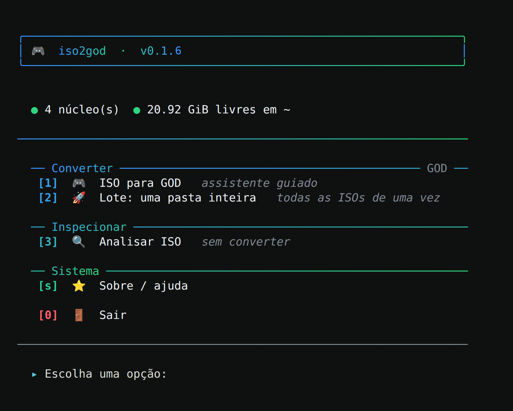

# iso2god-pt

[](https://github.com/lux-insider/iso2god-pt/releases/latest)
[](https://github.com/lux-insider/iso2god-pt/actions/workflows/testes.yml)
[](LICENSE)


Conversor de imagens ISO de **Xbox** e **Xbox 360** para pacotes **GOD**
(Games on Demand), em **Rust** e em português. Tem um assistente
interativo, conversão em lote, barra de progresso e uma saída em JSON para
integração com outros programas.

É uma implementação independente do formato GOD e do processo de conversão
do Iso2God original: nenhum código-fonte do projeto original foi copiado.



---

## Sumário

- [Recursos](#recursos)
- [Download](#download)
- [Uso](#uso)
- [Onde o pacote é gravado](#onde-o-pacote-é-gravado)
- [Integração com outros programas](#integração-com-outros-programas)
- [Segurança e confiabilidade](#segurança-e-confiabilidade)
- [Compilação](#compilação)
- [Estrutura do projeto](#estrutura-do-projeto)
- [Testes](#testes)
- [Documentação](#documentação)
- [Licença](#licença)

---

## Recursos

- **Detecção automática** de Xbox Original (`default.xbe`) e Xbox 360
  (`default.xex`): Title ID, Media ID, título e número do disco lidos da
  própria imagem.
- **Nome e ícone oficiais dos jogos de Xbox 360:** o `default.xex` é
  decifrado (AES) e descomprimido (básica ou LZX), e o recurso XDBF fornece o
  nome, no idioma padrão do jogo, e o ícone que o painel do console mostra.
- **Ícones de Xbox Original** convertidos de XPR (DXT1, ARGB e X8R8G8B8) para
  PNG.
- **Três estratégias de padding:** nenhuma remoção, remoção parcial (padrão)
  ou reconstrução completa da estrutura GDF.
- **Leitura e hash multi-thread**, configurável (`-j`/`--threads`).
- **Duas formas de uso:** assistente interativo ou linha de comando por
  flags.
- **Saída limpa fora do terminal:** sem códigos ANSI quando redirecionada;
  erros e avisos vão para stderr.

---

## Download

Baixe a versão mais recente na página de
[**Releases**](https://github.com/lux-insider/iso2god-pt/releases/latest).

| Arquivo | Sistema |
|---|---|
| `iso2god-linux-x86_64` | Linux x86_64 (glibc 2.34+) |
| `iso2god-windows-x86_64.exe` | Windows 10 e 11 (64 bits) |
| `SHA256SUMS.txt` | hashes para conferir os downloads |

No Linux, dê `chmod +x` no binário. No Windows não é preciso instalar nada:
o `.exe` não depende do Visual C++ Redistributable. No Windows Terminal
aparecem cores e emoji; no console clássico, símbolos simples no lugar dos
emoji.

---

## Uso

### Assistente interativo

```bash
iso2god
```

Sem argumentos, abre o menu:

- **Navegador de pastas:** escolha a imagem sem digitar o caminho. A lista
  mostra o tamanho e o layout de cada arquivo (Xsf, XGD1, XGD2, XGD3 ou `?`
  quando não é uma imagem de Xbox). `..` sobe, `c` digita um caminho e `t`
  seleciona todas as ISOs da pasta.
- **Assistente em quatro etapas:** destino, padding, threads e opções
  avançadas (título, ícone e numeração de disco), com resumo, espaço
  necessário e confirmação antes de converter.
- **Lote:** `2`, `1,3-5` ou `todas`. A falha de uma imagem não interrompe as
  outras, e um resumo aparece no fim.
- **Navegação:** `v` volta uma etapa, `q` sai, Enter aceita o padrão entre
  colchetes, Ctrl+D encerra e Ctrl+C cancela a conversão em andamento sem
  deixar arquivos pela metade.

Caminhos com `~`, com aspas ou com espaços escapados (arrastados do
gerenciador de arquivos para o terminal) são aceitos. O processo sai com
código 1 se alguma imagem do lote não converteu.

### Linha de comando

```bash
# conversão
iso2god converter "/caminho/do/jogo.iso" "/pasta/destino" -j 4

# informações da ISO (plataforma, Title ID, Media ID, título...)
iso2god info "/caminho/do/jogo.iso"
```

| Opção de `converter` | Função |
|---|---|
| `--padding <nenhuma\|parcial\|completa>` | estratégia de padding |
| `--title-id`, `--media-id` | substituem os valores lidos da imagem |
| `--titulo`, `--icone` | nome e ícone gravados no cabeçalho |
| `--disco`, `--total-discos` | numeração de jogos com vários discos |
| `-j`, `--threads` | número de threads |

A lista completa está em `iso2god converter --help`.

---

## Onde o pacote é gravado

```
<destino>/<Title ID>/<tipo de conteúdo>/<pacote>
                                        <pacote>.data/Data0000, Data0001, ...
```

O tipo de conteúdo é `00005000` para Xbox Original e `00007000` para Xbox 360.
É o mesmo layout que o console procura em `Content/0000000000000000/`: basta
copiar a pasta do Title ID para lá.

Exemplo: `iso2god converter jogo.iso /mnt/usb/` grava em
`/mnt/usb/545400A3/00005000/…`.

---

## Integração com outros programas

```bash
iso2god converter origem.iso destino/ --progresso-json
iso2god info origem.iso --json
```

Uma linha JSON por evento em stdout: fases, progresso (bytes, velocidade e
ETA), conclusão ou erro. É o protocolo usado pelo
[xiso-manager](https://github.com/lux-insider/xiso-manager). Avisos que
não param a conversão (ex.: `default.xex` ilegível) vêm como `fase` com
`"fase": "aviso"`. No `info --json`, quando o Title ID não pôde ser lido,
o campo `motivo_sem_metadados` diz por quê.

Quem chama sem console (um programa com janela no Windows não tem como
mandar Ctrl+C) passa `--cancelar-pela-entrada`, liga um pipe na entrada
padrão e o fecha para cancelar: a conversão para e apaga o pacote
incompleto, como no Ctrl+C. Se o programa que chamou morrer, o sistema
fecha o pipe e o efeito é o mesmo.

| Código de saída | Significado |
|---|---|
| 0 | sucesso |
| 1 | erro (ou, no lote, alguma imagem não converteu) |
| 1 | também opção ou argumento inválido na linha de comando (até a 0.1.5, 2) |
| 130 | cancelado (Ctrl+C, SIGTERM, terminal ou janela fechados, entrada fechada com `--cancelar-pela-entrada`) |

---

## Segurança e confiabilidade

- **Verificações antes de gravar:** a imagem precisa ser de Xbox ou Xbox 360,
  o destino precisa aceitar escrita e ter espaço livre para o pacote. A
  conversão é recusada no início em vez de falhar no meio.
- **Nada pela metade:** Ctrl+C, SIGTERM, fechar o terminal ou a janela e
  qualquer falha cancelam a conversão num ponto conhecido e apagam a saída
  incompleta. Um segundo Ctrl+C sai na hora.
- **Entradas hostis:** ISOs e executáveis malformados viram erro explicado,
  sem travar nem esgotar a memória (validado com fuzzing).
- **Links simbólicos** no destino não redirecionam a gravação.
- **Erros claros:** cada falha informa o arquivo e a operação.

---

## Compilação

Requisitos: [Rust](https://rustup.rs) estável (edição 2024).

```bash
git clone https://github.com/lux-insider/iso2god-pt.git
cd iso2god-pt
cargo build --release          # target/release/iso2god
cargo test --release
```

Para gerar o `.exe` do Windows a partir do Linux:

```bash
sudo apt install clang lld llvm
rustup target add x86_64-pc-windows-msvc
cargo install --locked cargo-xwin
cargo xwin build --release --target x86_64-pc-windows-msvc
```

O `.cargo/config.toml` liga o CRT estático, então o `.exe` não depende do
Visual C++ Redistributable.

---

## Estrutura do projeto

```
src/
├── main.rs, cli.rs       linha de comando e subcomandos
├── assistente.rs         menu interativo e navegador de pastas
├── analise.rs            detecção da plataforma e leitura dos metadados
├── gdf/                  leitura do sistema de arquivos do disco (GDF/XDVDFS)
├── god/                  gravação do pacote GOD: partes, hash tables e cabeçalho
├── xex/                  decifra e descompressão do default.xex, recurso XDBF
├── xbe/                  default.xbe e ícone XPR
├── progresso.rs          eventos de progresso e protocolo JSON
├── terminal.rs           cores, barra de progresso e símbolos
├── limpeza.rs            cancelamento e remoção da saída incompleta
├── uso.rs                ajuda e erros de uso em português
└── sistema.rs, erro.rs   espaço em disco, sinais e mensagens de erro
tests/                    testes de integração e saídas de referência (golden)
ferramentas/fuzz/         fuzzers de imagens corrompidas e XBEs forjados
```

---

## Testes

- **132 testes** (`cargo test --release`), incluindo saídas de referência
  (golden) que garantem que cada versão grava exatamente os mesmos bytes para
  entradas válidas.
- **Integração contínua** no GitHub Actions, no Linux e no Windows, em debug e
  em release.
- **Fuzzing** com milhares de imagens corrompidas e XBEs forjados
  ([ferramentas/fuzz](ferramentas/fuzz/README.md)).
- **Validação com jogos reais** no Xbox 360.

---

## Documentação

| Documento | Conteúdo |
|---|---|
| [CHANGELOG.md](CHANGELOG.md) | histórico de versões |
| [AUDITORIA.md](AUDITORIA.md) | auditoria de segurança e confiabilidade, com cada achado e sua correção |
| [ferramentas/fuzz/README.md](ferramentas/fuzz/README.md) | como rodar os fuzzers |

---

## Licença

Código sob a licença [MIT](LICENSE).
